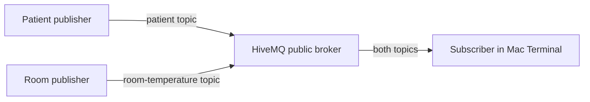

# Hospital Patient Monitoring System Using MQTT

This assignment uses two independent Python simulators to send synthetic readings to an external MQTT broker. A third program displays both feeds in your Mac terminal. You can complete the demonstration on a MacBook with Python 3.10 or newer and an internet connection.

## Objectives and architecture

- Simulate heart rate and systolic and diastolic blood pressure every 60 seconds.
- Simulate room temperature every 30 seconds.
- Route both feeds through HiveMQ’s public broker and display them with timestamps, device IDs and units.



A **publisher** sends messages to a named **topic**, which acts like a channel. A **subscriber** asks for messages on specific topics. The **broker** is the server that receives the publishes and forwards them to matching subscribers. The assignment requires an external server so the demonstration exercises MQTT communication with a remote host.

Each publisher uses `json.dumps()` to turn a Python dictionary into JSON text. Paho sends the text as bytes in an MQTT message. The subscriber decodes those bytes as UTF-8, parses the JSON, validates the fields and formats the readings with units.

## Install on macOS

Use these commands if you downloaded `MQTT_Hospital.zip` to Downloads.

```bash
mkdir -p "/Users/htet/Desktop/IOT/A1"
unzip -n "$HOME/Downloads/MQTT_Hospital.zip" -d "/Users/htet/Desktop/IOT/A1"
cd "/Users/htet/Desktop/IOT/A1/MQTT_Hospital"
python3 --version
python3 -m venv .venv
source .venv/bin/activate
python -m pip install -r requirements.txt
```

Check that `python3 --version` reports 3.10 or newer before creating the environment. The project uses Paho MQTT 2.1 with callback API version 2 and MQTT 3.1.1.

## Configuration

| Setting | Default |
| --- | --- |
| Broker host | `broker.hivemq.com` |
| Broker port | `1883` (plain TCP) |
| Topic prefix | `hospital-demo/a1-67f62ed60666` |
| Patient topic | `hospital-demo/a1-67f62ed60666/patient` |
| Room topic | `hospital-demo/a1-67f62ed60666/room-temperature` |

All three programs import `config.py`. The project-specific suffix reduces accidental cross-talk. If you distribute a copy, change the default topic prefix in that file or set the same `MQTT_TOPIC_PREFIX` in all three terminals. `MQTT_HOST` and `MQTT_PORT` override the broker address. Keep an external hostname for the assignment. Each simulator has its own device ID, and each process generates a separate MQTT client ID.

## Run in three Terminal tabs

**Terminal 1**

```bash
cd "/Users/htet/Desktop/IOT/A1/MQTT_Hospital"
source .venv/bin/activate
python subscriber.py
```

Wait for two `Subscribed` lines before starting the publishers.

**Terminal 2**

```bash
cd "/Users/htet/Desktop/IOT/A1/MQTT_Hospital"
source .venv/bin/activate
python publisher1.py
```

**Terminal 3**

```bash
cd "/Users/htet/Desktop/IOT/A1/MQTT_Hospital"
source .venv/bin/activate
python publisher2.py
```

Each publisher sends its first reading as soon as it connects. Press Ctrl+C in each terminal to stop it cleanly.

## Example messages

Patient reading:

```json
{"device_id":"hospital-demo/a1-67f62ed60666/patient-01","timestamp":"2026-11-23T17:45:00.000+00:00","readings":{"heart_rate_bpm":72,"systolic_mmhg":118,"diastolic_mmhg":76}}
```

Room reading:

```json
{"device_id":"hospital-demo/a1-67f62ed60666/room-01","timestamp":"2026-11-23T17:45:03.000+00:00","readings":{"temperature_c":22.1}}
```

Example subscriber output:

```text
Connected to broker.hivemq.com:1883
Subscribed: hospital-demo/a1-67f62ed60666/patient
Subscribed: hospital-demo/a1-67f62ed60666/room-temperature
Received 2026-11-23T17:45:00.104+00:00 | Patient monitor ['hospital-demo/a1-67f62ed60666/patient-01'] | Sampled 2026-11-23T17:45:00.000+00:00 | Heart rate 72 BPM | Systolic 118 mmHg | Diastolic 76 mmHg
Received 2026-11-23T17:45:03.090+00:00 | Room sensor ['hospital-demo/a1-67f62ed60666/room-01'] | Sampled 2026-11-23T17:45:03.000+00:00 | Temperature 22.1 °C
```

The publisher prints its topic and raw JSON after it sends the MQTT packet. Subscriber output verifies that the broker forwarded it.

## Test and verify

1. **Both feeds.** Check that Terminal 1 shows both device labels and the units shown above. Compare the device ID and sample timestamp with the publisher's JSON.
2. **Intervals.** Run all three processes for at least 125 seconds on a stable connection. Compare consecutive `Sampled` timestamps for the same device. Look for gaps near 60 seconds on the patient feed and 30 seconds on the room feed. Use sample times because arrival times also include network latency. The publishers schedule with a monotonic clock.
3. **Publisher stops.** Press Ctrl+C in Terminal 2. The patient feed stops while room messages continue. Restart `python publisher1.py` and look for a new patient reading.
4. **Subscriber stops.** Press Ctrl+C in Terminal 1. Both publishers continue to send. Restart `python subscriber.py`, wait for both subscriptions, and verify the next reading from each publisher appears.
5. **Automatic reconnect.** Briefly disconnect the Mac from the internet while the programs run. Allow enough time for the loss to be detected (up to about a minute), then reconnect. Watch for connection messages and both subscription confirmations. The next samples should arrive within one interval per publisher once connected. The processes use automatic retry with a delay of up to 30 seconds between attempts. QoS 0 and non-retained messages keep the demo focused on live delivery. Samples missed during an outage can be lost.
6. **Malformed messages.** With Terminal 1 running, open a fourth tab. Activate the same environment and run this from the project directory. Expect an `Ignored malformed message` line followed by normal readings as the simulators continue.

```bash
python -c 'from paho.mqtt.publish import single; from config import BROKER_HOST, BROKER_PORT, ROOM_TOPIC; single(ROOM_TOPIC, "not-json", hostname=BROKER_HOST, port=BROKER_PORT)'
```

## Troubleshooting

| Symptom | What to check |
| --- | --- |
| `ModuleNotFoundError: No module named 'paho'` | Activate `.venv` in that tab and install `requirements.txt`. |
| Repeated connection failures | Check the internet connection and run `nc -G 5 -vz broker.hivemq.com 1883`. A network can block MQTT traffic or the shared broker can be temporarily unavailable. |
| Subscribed but no readings | Verify both publishers are running. Check that all three programs use the same broker and topic prefix, and wait one full publishing interval. |
| Unexpected messages | Switch all three programs to a new shared prefix to reduce interference from other broker clients. |
| Timing test shows gaps | Repeat on a stable connection with your Mac awake. Compare sample times within each feed. |

## Security and privacy

Use synthetic data only. The public HiveMQ broker permits other clients to subscribe or publish. Port 1883 sends data without transport encryption, and a unique topic prefix reduces accidental interference but provides no access control. The device IDs identify simulated equipment. Keep real patient information, credentials and institutional identifiers out of both topics and payloads. This demo is for coursework.

## Assignment checklist

| Requirement | Implementation | Verification |
| --- | --- | --- |
| Patient heart rate and blood pressure each minute | `publisher1.py` samples heart rate in BPM and systolic/diastolic pressure in mmHg every 60 seconds | Check the two pressure values and heart rate in Terminal 1, then compare patient sample timestamps |
| Room temperature every 30 seconds | `publisher2.py` generates readings in °C every 30 seconds | Check room units and compare room sample timestamps |
| External broker and separate topics | `config.py` defines the HiveMQ endpoint and both topic names | Check the connection hostname and two subscription confirmations |
| JSON, timestamp and unique device IDs | Shared publisher loop encodes each reading with a UTC timestamp and a distinct ID | Inspect both publisher logs and match entries to Terminal 1 |
| Subscriber shows both feeds and handles bad messages | `subscriber.py` validates and formats both payloads | Run both publishers and the malformed message test |
| Reconnection and clean shutdown | Shared client retries connections, and the subscriber renews subscriptions | Test a network outage and Ctrl+C |
| Python 3.10+ and Paho 2.x | `requirements.txt` pins Paho 2.1.0 | Check `python --version` and `python -m pip show paho-mqtt` inside the environment |

## Conclusion

Two independent simulators demonstrate how MQTT routes structured telemetry from publishers through an external broker to a single subscriber. The terminal displays enough information to verify each feed’s identity, readings and cadence.

References: [HiveMQ public broker](https://www.hivemq.com/mqtt/public-mqtt-broker/) and [Eclipse Paho Python client documentation](https://eclipse.dev/paho/files/paho.mqtt.python/html/).


mkdir -p "/Users/htet/Desktop/IOT/A1"
unzip -n "$HOME/Downloads/MQTT_Hospital.zip" -d "/Users/htet/Desktop/IOT/A1"
cd "/Users/htet/Desktop/IOT/A1/MQTT_Hospital"
python3 --version
python3 -m venv .venv
source .venv/bin/activate
python -m pip install -r requirements.txt

cd "/Users/htet/Desktop/IOT/A1/MQTT_Hospital"
source .venv/bin/activate

python subscriber.py

cd "/Users/htet/Desktop/IOT/A1/MQTT_Hospital"
source .venv/bin/activate
python publisher1.py

cd "/Users/htet/Desktop/IOT/A1/MQTT_Hospital"
source .venv/bin/activate
python publisher2.py

!!!!!!!!!!!!!!!!!!!!!!!!!!!!!!!!!!!!!!!!!!!!!!!!!!!!!!!!!!!!!!!!!!!!!!!!!!!!!!!!!!!!!!!!!!!!!!!!!!!!!!!!!!!!!!!!!!!!!!!!!!!!!!!!!!!!!
Part	        :Role in your project
config.py       :Configuration of server haappen
publisher1.py	:Sends heart rate and blood pressure to the patient topic every 60 seconds.
publisher2.py	:Sends room temperature to the room-temperature topic every 30 seconds.
HiveMQ broker	:Receives each reading and forwards it to clients subscribed to that topic.
subscriber.py	:Subscribes to both topics and prints each reading as it arrives.
!!!!!!!!!!!!!!!!!!!!!!!!!!!!!!!!!!!!!!!!!!!!!!!!!!!!!!!!!!!!!!!!!!!!!!!!!!!!!!!!!!!!!!!!!!!!!!!!!!!!!!!!!!!!!!!!!!!!!!!!!!!!!!!!!!!!!

